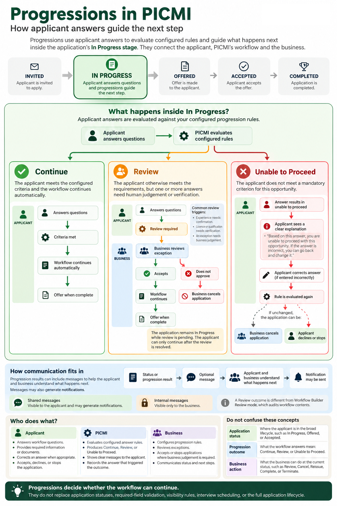

# Progressions in workflows

Progressions in workflows decide what happens next when a participant answers workflow questions. They support clear,
fair,
and transparent decision-making for both businesses and participants. Progressions do not manage the full application
lifecycle. They only decide whether the participant can:

- continue automatically
- move to review
- be marked unable to proceed to offer/accept

The goal is to maximise straight-through progression while still allowing human judgement where needed.

See the [Progressions one-pager in PICMI at a glance](./picmi-at-a-glance.md#understanding-progressions) for a visual
summary of the applicant, workflow, and business flows.

::: prompt
Use a Review outcome only when the participant has otherwise passed and limited human judgement remains. This enables
fast progression while preserving business flexibility where review is genuinely needed.
:::

::: prompt
A **Review** outcome in Progressions is different from workflow builder **Review mode**. Review mode is for auditing
workflow
contents in a table.
:::

## Progression outcomes

PICMI workflows produce only three progression outcomes:

| Outcome           | Meaning                                                                                |
|-------------------|----------------------------------------------------------------------------------------|
| Continue          | The participant meets the criteria and can continue automatically.                     |
| Review            | The participant meets the criteria overall, but one or more answers need human review. |
| Unable to Proceed | Based on the answers provided, the participant cannot continue with this opportunity.  |

These outcomes are separate from broader application statuses (invited, in progress, offered, accepted, declined,
withdrawn)

Progressions only determine whether the workflow can continue automatically.

A **Business Declined** progression review records the outcome of a review. It does not automatically change the
application's overall status. For example, an application can remain **In Progress** while the business decides what to
do next. If the business wants to end the application, it must [cancel the application](../article/changing-application-status).
Keeping cancellation separate allows the business to manage status messages and applications with more than one item
requiring review.

:::: explanation

## Continue

A Continue outcome means:

- required criteria are met
- no further human judgement is needed
- the workflow progresses automatically

### Example

> A participant confirms they can legally work in New Zealand, are available for required dates, agree to safety
> requirements, and meet experience requirements.

::::

:::: explanation

## Review

A Review outcome means:

- the participant has otherwise met workflow requirements
- one or more answers require human judgement or verification
- if approved, the participant should continue forward without repeating completed steps

::: prompt
Important Principle

Review is different from an incomplete application. Use Review only when all other required checks have passed.
:::

### Examples of review triggers

- experience needs confirmation
- licences need verification
- exception requires employer judgement

### Example

> A participant passes work rights, availability, transport, and safety checks, but pruning experience requires
> verification.
> ::::

:::: explanation

## Unable to Proceed

An Unable to Proceed outcome means the participant does not meet mandatory criteria for that opportunity.

### Examples

- not legally allowed to work
- unavailable for mandatory dates
- refusal of required safety conditions
- missing mandatory licence or qualification

The system should clearly explain why they cannot continue.

### Example message

> “This opportunity requires current legal work rights in New Zealand. Based on your answer, you are unable to proceed
> with this opportunity.”

::::

## Allowing Participants to Correct Answers

If a participant receives Unable to Proceed, do not immediately trap or block them.

Participants should:

- see a clear explanation
- be encouraged to stop if the answer is correct
- be able to change an incorrect answer

This supports fairness and reduces accidental drop-off.

### Example message

> “Based on this answer, you are unable to proceed with this opportunity. If this answer is incorrect, you may go back
> and change it.”

## Recording Why Someone Stops

PICMI records:

- which answer triggered the outcome
- whether they were declined
- whether they exited the workflow

This supports:

- drop-off analysis
- workflow improvement
- barrier identification
- better business criteria and messaging

## Multiple Review Items

A participant may have multiple items requiring review.

### Example

- experience requires review
- transport arrangements require review
- qualification evidence requires review

Participants should see this clearly.

### Example message

> “Your application requires review for three items before it can proceed.”

## Review requests and unanswered questions

Progression rules determine whether an answer can continue automatically, needs business review, or means the
participant
cannot proceed. PICMI checks answers that a jobseeker submits against these rules. An unanswered question is not treated
as completed or reviewed.

A jobseeker can request a review after answering just one question that triggers review, even if other questions with
progression rules are still unanswered. They can also request review without completing the first page or all questions
with progression rules. Early review requests are allowed by design; they are not a system error. Some jobseekers may
choose to answer one review-triggering question at a time.

On the first page, progression rules are checked to give the jobseeker guidance, but that check is not enforced. PICMI
encourages jobseekers to complete all questions on that page before requesting review so the business has a fuller
picture of the application. This is a recommendation, not a requirement.

Clear workflow instructions can help jobseekers understand why completing more questions before requesting review is
useful. If early requests become a business problem and instructions do not resolve it, contact PICMI with details of
the workflow and the number of people affected. PICMI can investigate and consider possible solutions.

## What Progressions Are Not

Progressions should stay simple and focused.

It is not responsible for:

- format or required-field validation
- workflow visibility conditions
- meeting scheduling
- interview arrangement
- additional evidence collection
- alternative opportunity recommendations
- recruiter task management

Progressions only determine:

- Continue
- Review
- Unable to Proceed

## Visibility and required state

Visibility and required state are related to Progressions, but they are different.

| Concept                  | Meaning                                                                                     |
|--------------------------|---------------------------------------------------------------------------------------------|
| **Required state**       | Whether the participant must complete an item before continuing                             |
| **Visibility condition** | Whether the participant sees an item, such as **visible when...** a previous answer matches |
| **Progression outcome**  | Whether the participant can continue, needs review, or is unable to proceed                 |

For example, a question can be visible only when a participant gives a certain answer. A different rule can then decide
whether that answer allows the participant to continue, requires review, or means they are unable to proceed.

## Configure progression rules

In the Workflow Builder, progression rules connect a question answer to a progression outcome. The **Progressions**
panel is
available as a Beta feature.

1. Open **Setup** > **Workflows** and select **Edit** mode.
2. Select **Progressions**.
3. Select **Add progression rule**.
4. Choose a question, its answer choice, and the outcome: **Review** or **Unable to Proceed**.
5. Add an optional participant message and progression action when available.
6. Save the rule.

PICMI treats **Continue** as the default path, so Continue answers are not listed in the progression summary. Use the
search and outcome/page filters to find configured rules. Select a rule to edit it, or use **Remove rule** to
permanently
delete it.

## Progression actions

Progression actions are reusable organisation settings that can be attached to a progression rule. The current action
types are **Scheduling**, **Evidence request**, and **Approval**. Available providers include **Ad hoc URL** and
**Calendly**.

Manage them from **Setup** > **Progression actions**. Create an action, choose its type and provider, complete the
provider settings, and save it. Archived actions remain visible when archived items are included, but should not be
used for new rules.

## Customer Configuration

Progression rules are configured in the Workflow Builder's **Progressions** panel while the feature is available as
Beta.

### Example 1

If the participant answers No to “Are you legally allowed to work in New Zealand?”, set the outcome to Unable to Proceed
and
show:

> “This opportunity requires current legal work rights in New Zealand.”

### Example 2

If pruning experience is less than one season, set an outcome to Review.

Configuration should be simple for non-technical users.

## Participant Experience

Participants should always understand what is happening.

### Continue

> “You meet the requirements and can continue.”

### Review

> “Your application meets the requirements overall, but one or more answers need review before the next step.”

### Unable to Proceed

> “Based on your answers, you are unable to proceed with this opportunity.”

Use respectful, clear, and transparent language in all cases.

## Benefits

### For Businesses

- faster processing of suitable participants
- reduced manual screening
- clearer exception handling
- less repeated communication
- more consistent decisions
- better visibility into why participants stop or require review

### For Participants

- clear expectations
- faster progression
- transparent outcomes
- respectful communication
- reduced uncertainty
- less repeated information gathering

## Troubleshooting

- [Workflow progression FAQs](../faqs.md#workflow-progressions)
