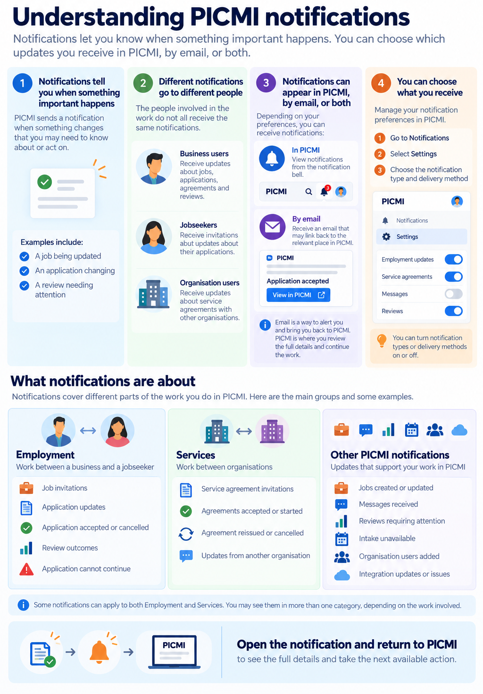

# Notifications in PICMI (Business)

PICMI sends notifications when an application, agreement, job, message, organisation, intake setting, or integration
changes. Notifications can be delivered in the app or by email, depending on your notification preferences.

In the table below, the **actor** is the person, organisation, or system that caused the change. The **recipient** is
the person or organisation that receives the notification.

For notifications received by people applying for work, see [Jobseeker notifications](../../jobseeker/article/notifications.md).

For a visual overview of notification groups and delivery methods, see [Understanding notifications](../about-picmi/picmi-at-a-glance.md#understanding-notifications).

## Notification types

| Notification                                             | What happened                                                                                        | Who made the change                   | Who receives it                           |
|----------------------------------------------------------|------------------------------------------------------------------------------------------------------|---------------------------------------|-------------------------------------------|
| **Employment application — accepted**                    | An employment application was accepted.                                                              | Applicant/jobseeker                   | Organisation users                        |
| **Employment application — cancelled by applicant**      | An employment application was cancelled.                                                             | Applicant/jobseeker                   | Organisation users                        |
| **Employment application — updates**                     | An application message, agreement update, or related issue occurred.                                 | Jobseeker, organisation, or system    | Organisation users                        |
| **Service agreement — accepted by you**                  | A service agreement was accepted.                                                                    | Your organisation                     | Your organisation's users                 |
| **Service agreement — accepted by another organisation** | A service agreement was accepted by another organisation.                                            | Another organisation                  | Your organisation's users                 |
| **Service agreement — started**                          | A service agreement was started.                                                                     | Another organisation                  | Your organisation's users                 |
| **Service agreement — invitation received**              | A service agreement invitation was sent.                                                             | Another organisation                  | Your organisation's users                 |
| **Service agreement — reissued**                         | A service agreement was updated and sent for review again.                                           | Sending organisation                  | Receiving organisation's users            |
| **Service agreement — cancelled**                        | A service agreement was cancelled.                                                                   | Participating organisation            | Other participating organisation's users  |
| **Application — review required**                        | An application answer requires a progression review.                                                 | System, based on application answers  | Organisation reviewers                    |
| **Application — review completed**                       | A progression review was completed.                                                                  | Organisation reviewer                 | Relevant participant or organisation user |
| **Application — cannot continue**                        | An application cannot proceed based on its answers.                                                  | System, based on application answers  | Relevant participant or organisation user |
| **Message — received**                                   | A message was received.                                                                              | Another user or organisation          | Message recipient                         |
| **Message — sent by another user**                       | A message was sent to another participant.                                                           | Another user or organisation          | Message recipient                         |
| **Organisation user — added**                            | A new user joined the organisation.                                                                  | New or existing organisation user     | Organisation users                        |
| **Job updates**                                          | An employment job was created or updated.                                                            | Organisation user                     | Organisation users                        |
| **Intake — unavailable**                                 | An opportunity cannot accept intake because it is closed, outside its intake window, or at capacity. | System, based on opportunity settings | Organisation users                        |
| **Integration updates**                                  | An integration-related system event occurred.                                                        | System or external integration        | Organisation administrators               |

## Managing your notifications

You can manage your notification preferences for these notification types in the PICMI app.

::: prompt
By default, notifications are enabled for all delivery methods.
:::

::: instructions

### Manage preferences

1. Sign in to your PICMI account.
2. Click **Notifications** :::icon bell-outline:::
3. Select **Settings** :::icon cog-outline:::
4. Click :::icon chevron-down open::: next to a notification type to see its delivery methods.
5. Enable or disable :::icon toggle-switch-outline::: each delivery method.
   :::

## Managing messages

The notification bell :::icon bell-outline::: shows a green dot when there are **new** messages.

::: explanation

### Viewing messages

Click the notification bell :::icon bell-outline::: to see the latest messages. New messages are in bold, while
previously read messages are dimmed. Each message shows how long ago it arrived.

### Mark message as read/unread

To mark a message as read, either click the item or use the menu :::icon horizontal-dots:::. Select **Mark as read** or
**Mark as unread**.

### Mark all messages as read

A quick approach is to mark all messages as read. You can mark individual messages as unread.

### Remove message

You can remove messages from the list. This cannot be undone.
:::
