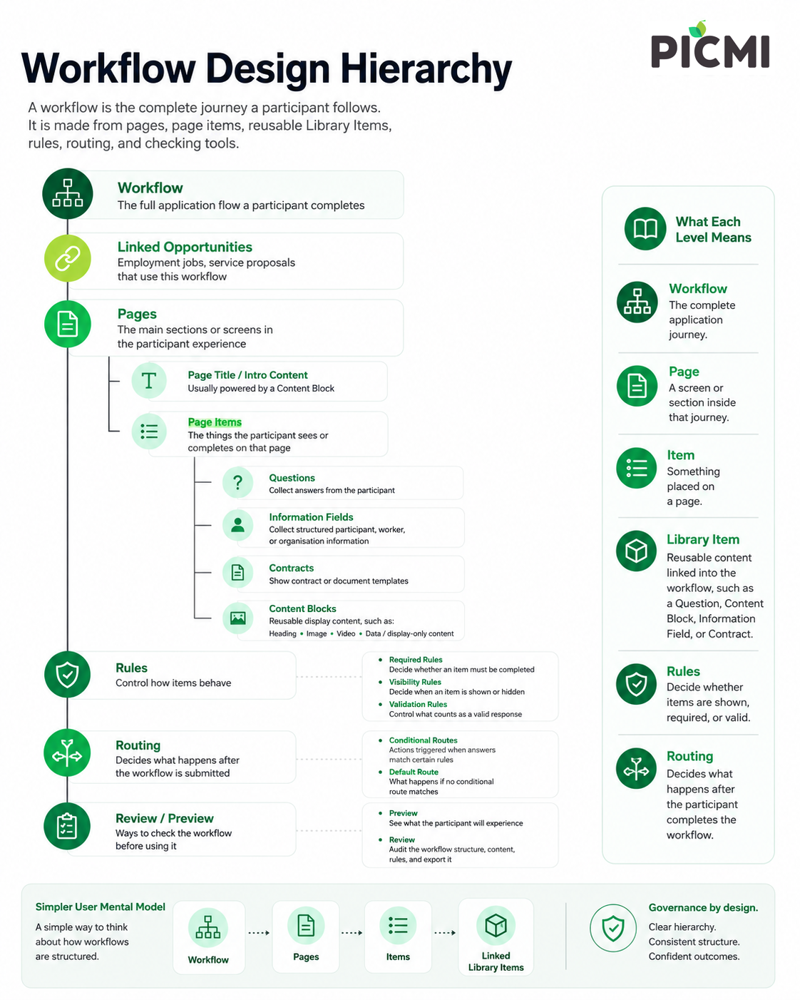

# Workflow Builder overview

The Workflow Builder is where you create and maintain the participant journey for an application or onboarding workflow.
It brings together pages, workflow items, and reusable Library Items such as questions, Information, contract templates,
and Content Blocks.

## Who this is for

This article is for organisation and business users who create or maintain workflows. Understand the business process
you want participants to complete before you begin.

## Open a workflow

::: instructions

1. Go to **Setup** > **Workflows**.
2. Locate the workflow row, click &vellip; (vertical dots) to open the menu.
3. Choose **Edit**, **Preview**, or **Review** mode.

:::

## Builder modes

| Mode        | Use it to                                                                         |
|-------------|-----------------------------------------------------------------------------------|
| **Edit**    | Change the workflow structure, page and item placement, and linked Library Items. |
| **Preview** | Check the participant experience on desktop, tablet, and mobile.                  |
| **Review**  | Inspect the workflow structure and export its contents.                           |

::: prompt **Review** is for checking the workflow structure. It is different from a **Review** outcome in Progressions,
which is not
available for configuration in the current Workflow Builder interface.
:::

## Workflow structure and reusable content

The workflow controls where content appears. A Library Item controls the reusable content itself.

| Workflow part     | What it does                                                                |
|-------------------|-----------------------------------------------------------------------------|
| **Page**          | Groups related content and gives participants a clear stage in the journey. |
| **Workflow item** | Places a question, Information, contract, or Content Block on a page.       |
| **Library Item**  | Stores reusable content that can be linked to one or more workflows.        |

Workflow item types include **Question**, **Information**, **Contract**, **Page title**, **Heading**, **Image**,
**Video**, and **Data**. Questions, Information, contracts, and Content Blocks are reusable Library resources; the
workflow determines their placement and order.

## Workflow details and status

Depending on your permissions and the workflow, the workflow details show its title, description, linked opportunities,
and whether it is in **Draft** or **Live** status.

- Use the title and description to identify the purpose of the workflow.
- Check linked opportunities before making a structural change, because the change may affect more than one opportunity.
- Treat **Draft** and **Live** as status information. The exact process for changing a workflow to **Live** needs
  confirmation from the PICMI product team.

## Validation and issues

Use **Validate** after structural changes and before making a workflow live. Validation identifies workflow problems and
shows where they occur. Open the affected page or workflow item to inspect the details, then follow the suggested
resolution.

Validation is separate from **Preview**: Preview checks the participant experience, while validation checks whether the
workflow contains issues that need attention.

## Related articles

- [Understanding workflows](../about-picmi/understanding-workflows.md)
- [Understanding workflow items](../about-picmi/understanding-workflow-items.md)
- [Create and organise workflow pages](./updating-workflows.md)
- [Add and reuse Library Items](./adding-library-items.md)
- [Preview a workflow](./previewing-workflows.md)
- [Review and export a workflow](./reviewing-workflow-contents.md)
- [Validate and troubleshoot workflow issues](./validating-workflows.md)
